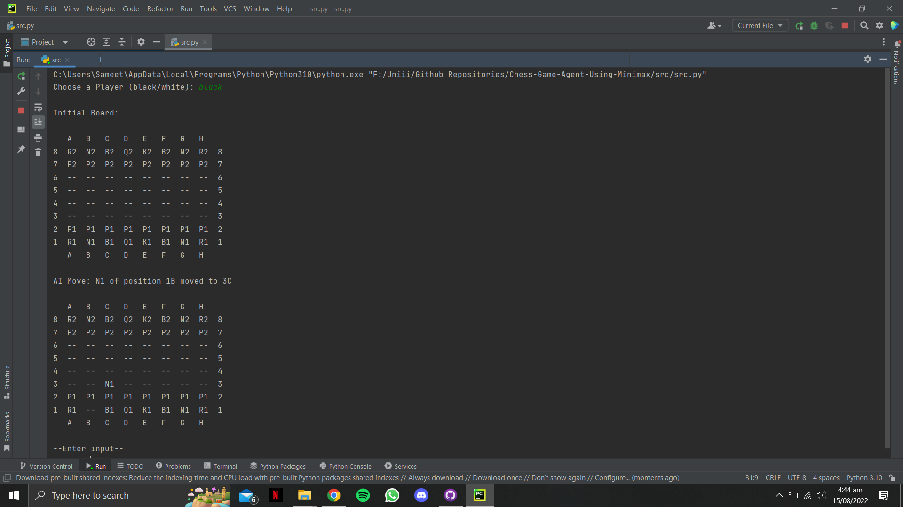
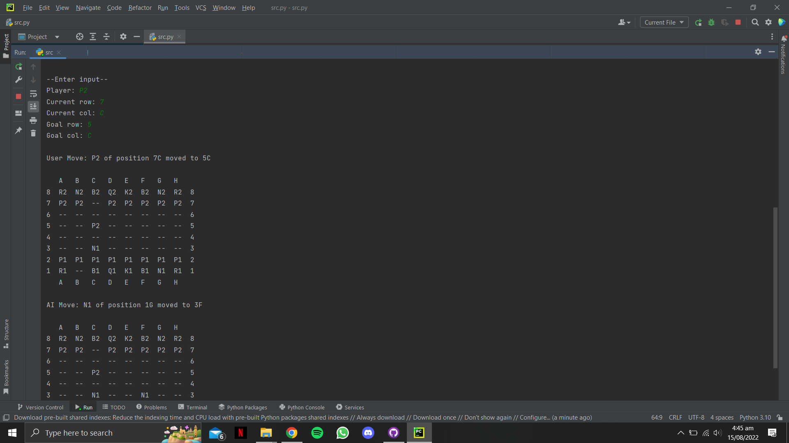

<h1 align="center">Chess Game Agent Using Minimax</h1>

### Description
A Python chess agent that evaluates candidate moves with minimax search. The supporting [problem specification](docs/problem-specification.pdf) and [project report](docs/project-report.pdf) are retained with the implementation. Run `src/src.py` to start the game.

### Working Screenshots

  

 

  

### Contributors
- [Sameet Asadullah](https://github.com/SameetAsadullah)
- [Aysha Noor](https://github.com/ayshanoorr)
